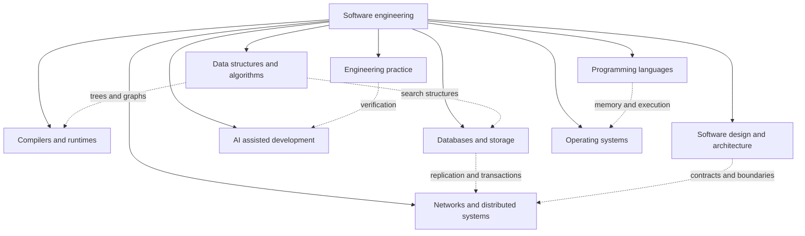

# CSTREE

A computer science knowledge tree for learning and practicing software engineering. Start with data structures and language semantics, follow how programs execute, then connect design decisions to data, operating systems, networks, and reliable delivery.

The seed contains **76 concept notes, 5 milestone papers, and 11 primary-reference notes**, organized into nine branches. Every concept includes a mechanism, a worked example, engineering tradeoffs, and typed graph connections. This is a useful starting map rather than an exhaustive encyclopedia.

## Explore the graph

- Open `index.html` in a browser for the self-contained visual explorer. Search titles, aliases, and note text; filter by branch; switch between the tree and graph; follow prerequisites and connections in the reading panel. It works without a server or external libraries.
- Open this folder as an Obsidian vault for linked notes, backlinks, and its native Graph view. Ordinary relative Markdown links also work in other Markdown readers.
- Use `graph.json` for your own analysis or viewer. Markdown is the source of truth; JSON and the explorer are derived outputs.

## The knowledge tree

The tree gives each concept one home. Cross-links make it a graph: a queue connects to messaging, a tree to indexes, and language ownership to operating-system memory. A branch is a navigation group, not a claim that every child requires the branch's first note.



### Data structures and algorithms · 15 concepts

- [Discrete Mathematics for Software](concepts/discrete-mathematics.md)
- [Algorithm Analysis](concepts/algorithm-analysis.md)
- [Data Structures and Algorithms](concepts/data-structures-and-algorithms.md)
- [Arrays and Linked Lists](concepts/arrays-and-linked-lists.md)
- [Stacks](concepts/stacks.md)
- [Queues and Deques](concepts/queues.md)
- [Hash Tables](concepts/hash-tables.md)
- [Trees and Search Trees](concepts/trees.md)
- [Heaps and Priority Queues](concepts/heaps.md)
- [Graphs and Graph Algorithms](concepts/graphs.md)
- [Searching and Binary Search](concepts/searching.md)
- [Sorting Algorithms](concepts/sorting.md)
- [Recursion and Backtracking](concepts/recursion-and-backtracking.md)
- [Dynamic Programming](concepts/dynamic-programming.md)
- [Greedy Algorithms](concepts/greedy-algorithms.md)

### Programming languages · 13 concepts

- [Programming Languages](concepts/programming-languages.md)
- [Type Systems](concepts/type-systems.md)
- [Memory Management and Ownership](concepts/memory-management.md)
- [Programming Paradigms](concepts/programming-paradigms.md)
- [C](concepts/c.md)
- [C++](concepts/cpp.md)
- [Java](concepts/java.md)
- [Python](concepts/python.md)
- [C#](concepts/csharp.md)
- [Go](concepts/go.md)
- [Rust](concepts/rust.md)
- [JavaScript](concepts/javascript.md)
- [TypeScript](concepts/typescript.md)

### Compilers and runtimes · 4 concepts

- [Compilers and Toolchains](concepts/compilers.md)
- [Parsing and Abstract Syntax Trees](concepts/parsing-and-asts.md)
- [Intermediate Representation and Optimization](concepts/intermediate-representation.md)
- [Runtimes and Program Execution](concepts/runtimes-and-execution.md)

### Software design and architecture · 7 concepts

- [Software Design Principles](concepts/software-design.md)
- [Design Patterns](concepts/design-patterns.md)
- [Creational Design Patterns](concepts/creational-patterns.md)
- [Structural Design Patterns](concepts/structural-patterns.md)
- [Behavioral Design Patterns](concepts/behavioral-patterns.md)
- [Software Architecture](concepts/architecture.md)
- [API Design and Contracts](concepts/api-design.md)

### AI assisted development · 3 concepts

- [AI Assisted Software Development](concepts/ai-assisted-development.md)
- [Vibe Programming and Vibe Coding](concepts/vibe-programming.md)
- [Agentic Software Development](concepts/agentic-development.md)

### Databases and storage · 7 concepts

- [Databases](concepts/databases.md)
- [The Relational Model and SQL](concepts/relational-model-and-sql.md)
- [Data Modeling and Schema Evolution](concepts/data-modeling.md)
- [Indexes and Query Planning](concepts/indexes-and-query-planning.md)
- [Transactions and Isolation](concepts/transactions.md)
- [Database Storage and Recovery](concepts/storage-and-recovery.md)
- [Nonrelational Data Models](concepts/nosql.md)

### Operating systems · 6 concepts

- [Operating Systems](concepts/operating-systems.md)
- [Processes and Threads](concepts/processes-and-threads.md)
- [Synchronization and Concurrency Control](concepts/synchronization.md)
- [Virtual Memory](concepts/virtual-memory.md)
- [File Systems and Persistence](concepts/file-systems.md)
- [I/O and Event Loops](concepts/io-and-event-loops.md)

### Networks and distributed systems · 11 concepts

- [Computer Networks](concepts/computer-networks.md)
- [HTTP and Remote Procedure Calls](concepts/http-and-rpc.md)
- [Distributed Systems](concepts/distributed-systems.md)
- [Consistency Models and CAP](concepts/consistency-models.md)
- [Replication and Consensus](concepts/replication-and-consensus.md)
- [Partitioning and Sharding](concepts/partitioning-and-sharding.md)
- [Messaging and Event Streams](concepts/messaging-and-streams.md)
- [Caching](concepts/caching.md)
- [Time and Ordering](concepts/time-and-ordering.md)
- [Resilience and Idempotency](concepts/resilience-and-idempotency.md)
- [Distributed Transactions and Sagas](concepts/distributed-transactions.md)

### Engineering practice · 10 concepts

- [Requirements and Specifications](concepts/requirements-and-specifications.md)
- [Software Testing](concepts/testing.md)
- [Debugging and Profiling](concepts/debugging-and-profiling.md)
- [Version Control and Git](concepts/version-control.md)
- [Build Systems and Dependencies](concepts/build-and-dependencies.md)
- [Continuous Integration and Delivery](concepts/ci-cd.md)
- [Observability and Reliability](concepts/observability.md)
- [Security Engineering](concepts/security-engineering.md)
- [Performance Engineering](concepts/performance-engineering.md)
- [Formal Methods and Verification](concepts/formal-methods.md)

## Suggested learning routes

These are reading sequences, not historical evolution or a claim that every adjacent pair has a prerequisite relationship. A note's `requires` links identify its actual prerequisites; follow those when a route starts beyond your current background.

- **Foundations:** [Discrete Mathematics for Software](concepts/discrete-mathematics.md) → [Algorithm Analysis](concepts/algorithm-analysis.md) → [Arrays and Linked Lists](concepts/arrays-and-linked-lists.md) → [Stacks](concepts/stacks.md) → [Queues and Deques](concepts/queues.md) → [Hash Tables](concepts/hash-tables.md) → [Trees and Search Trees](concepts/trees.md) → [Graphs and Graph Algorithms](concepts/graphs.md) → [Searching and Binary Search](concepts/searching.md) → [Sorting Algorithms](concepts/sorting.md) → [Recursion and Backtracking](concepts/recursion-and-backtracking.md) → [Greedy Algorithms](concepts/greedy-algorithms.md) → [Dynamic Programming](concepts/dynamic-programming.md)
- **Choose and understand a language:** [Programming Languages](concepts/programming-languages.md) → [Type Systems](concepts/type-systems.md) → [Memory Management and Ownership](concepts/memory-management.md) → [Programming Paradigms](concepts/programming-paradigms.md)
- **How code runs:** [Compilers and Toolchains](concepts/compilers.md) → [Parsing and Abstract Syntax Trees](concepts/parsing-and-asts.md) → [Intermediate Representation and Optimization](concepts/intermediate-representation.md) → [Runtimes and Program Execution](concepts/runtimes-and-execution.md) → [Operating Systems](concepts/operating-systems.md)
- **Build a maintainable service:** [Requirements and Specifications](concepts/requirements-and-specifications.md) → [Software Design Principles](concepts/software-design.md) → [Design Patterns](concepts/design-patterns.md) → [API Design and Contracts](concepts/api-design.md) → [Software Testing](concepts/testing.md) → [Databases](concepts/databases.md) → [HTTP and Remote Procedure Calls](concepts/http-and-rpc.md) → [Software Architecture](concepts/architecture.md)
- **Reliable data across machines:** [Transactions and Isolation](concepts/transactions.md) → [Distributed Systems](concepts/distributed-systems.md) → [Time and Ordering](concepts/time-and-ordering.md) → [Consistency Models and CAP](concepts/consistency-models.md) → [Replication and Consensus](concepts/replication-and-consensus.md) → [Messaging and Event Streams](concepts/messaging-and-streams.md) → [Distributed Transactions and Sagas](concepts/distributed-transactions.md) → [Resilience and Idempotency](concepts/resilience-and-idempotency.md)
- **Ship and operate:** [Version Control and Git](concepts/version-control.md) → [Build Systems and Dependencies](concepts/build-and-dependencies.md) → [Continuous Integration and Delivery](concepts/ci-cd.md) → [Observability and Reliability](concepts/observability.md) → [Debugging and Profiling](concepts/debugging-and-profiling.md) → [Performance Engineering](concepts/performance-engineering.md) → [Security Engineering](concepts/security-engineering.md)
- **Use AI with engineering judgment:** [Requirements and Specifications](concepts/requirements-and-specifications.md) → [Software Testing](concepts/testing.md) → [AI Assisted Software Development](concepts/ai-assisted-development.md) → [Vibe Programming and Vibe Coding](concepts/vibe-programming.md) → [Agentic Software Development](concepts/agentic-development.md)

For the language route, continue into one of C, C++, Java, Python, C#, Go, Rust, JavaScript, or TypeScript, then compare a second language through the same small tasks.

## Practice projects

- **A dependency-aware task runner:** represent tasks as a graph, reject cycles, schedule ready work, bound concurrency, and explain cancellation and retries.
- **A tiny language:** tokenize arithmetic, build an AST, evaluate it, then inspect an IR. Add malformed-input diagnostics and compare interpreted and compiled execution.
- **An order service:** model orders and line items, enforce constraints, inspect a query plan, reproduce a concurrent update, then add an outbox and idempotent consumer.
- **A measured AI change:** specify a small feature, generate a candidate, inspect the diff, test edge cases independently, and record total effort including corrections.

## Milestone papers and primary references

Use a few durable papers for branch foundations and official documentation for implementation contracts. A source being linked does not imply it introduced a concept. Paper notes distinguish contributions and limits; reference notes give scope and a reading route. Dynamic-programming and distributed-protocol examples here are original teaching examples.

- **book:** [Introduction to Algorithms](references/algorithms-reference.md)
- **specification:** [Language Specifications and Official Guides](references/language-specifications.md)
- **documentation:** [LLVM Language Implementation Tutorial](references/llvm-tutorial.md)
- **book:** [Operating Systems Three Easy Pieces](references/operating-systems-book.md)
- **documentation:** [PostgreSQL Database Documentation](references/postgresql-documentation.md)
- **book:** [Design Patterns Elements of Reusable Object-Oriented Software](references/design-patterns-book.md)
- **guide:** [Software Engineering and Git Guides](references/software-construction.md)
- **specification:** [HTTP and Transport Specifications](references/http-semantics.md)
- **book:** [Site Reliability Engineering](references/sre-book.md)
- **guide:** [OWASP Application Security Verification Standard](references/security-guides.md)
- **evidence:** [AI Development Experience and Productivity Evidence](references/ai-development-evidence.md)
- **1954:** [Some Applications of the Theory of Dynamic Programming—A Review](papers/bellman-1954-dynamic-programming.md)
- **1970:** [A Relational Model of Data for Large Shared Data Banks](papers/codd-1970-relational-model.md)
- **1978:** [Time, Clocks, and the Ordering of Events in a Distributed System](papers/lamport-1978-time-clocks.md)
- **2014:** [In Search of an Understandable Consensus Algorithm](papers/ongaro-2014-raft.md)
- **2012:** [Perspectives on the CAP Theorem](papers/gilbert-lynch-2012-cap-perspectives.md)

## Graph conventions

- **One file per node.** `README.md` is the hub; `concepts/`, `papers/`, and `references/` contain graph nodes. IDs match filenames, except this hub's `cstree` ID.
- **One canonical concept.** Use `branch` for its tree home and `domains` for cross-cutting context. Use `aliases` for search rather than duplicating notes.
- **Typed links.** A line such as `- **requires:** [Trees](trees.md)` creates a directed `requires` edge from the current note to Trees. All node links on that line have the same relation. Other local node links become `related_to` edges. Exact duplicate triples collapse.
- **Relation direction.** `A requires B` means read B before A. `contains` is navigational, `uses` is a mechanism dependency, `compares_with` is a comparison, and `supported_by` points to a source. Inverses are not automatically generated.
- **Full graph cycles are useful.** Reciprocal comparisons and source backlinks are normal. Only the `requires` subgraph must be acyclic.
- **Portable links.** Use relative inline Markdown links to whole nodes. External URLs are source attributes. Do not create links to notes that do not yet exist. Code fences are excluded from graph extraction.
- **Evidence.** Every concept must reach a primary reference or paper without passing through the entry hub. A direct source link is preferred. References and papers each need an incoming concept link and a primary external URL.

The accepted vocabulary is `requires`, `contains`, `uses`, `used_by`, `specialization_of`, `specialized_by`, `extends`, `extended_by`, `compares_with`, `related_to`, `introduced_in`, `popularized_by`, `supported_by`, `applied_in`, and `explains`.

## Check and rebuild

Python 3.10 or newer is sufficient; there are no package dependencies. Run from this folder:

```bash
python3 tools/check_graph.py --export graph.json
python3 tools/build_viewer.py
python3 -m unittest discover -s tools -p 'test_*.py'
```

The checker validates metadata, node identities, branch names, sections, local links, relation labels, prerequisite cycles, hub reachability, connectivity without the hub, and primary-source paths. It does not establish factual correctness or external link availability. The viewer builder validates and reexports before embedding the notes, so it cannot silently publish an invalid graph. Rebuild both derived outputs after changing notes.

## Grow the tree

Add a note when it explains a distinct mechanism or answers a concrete engineering question. Keep its explanation, worked example, tradeoffs, source, and links useful before adding another level. Possible future branches include computer architecture, automata and computability, programming-language theory, UI engineering, accessibility, and specialized application domains. These are future scope, not empty nodes in this seed.

New concept front matter uses a small YAML subset: scalar values and JSON-style lists. Follow an existing note and include `id`, `type`, `title`, `aliases`, `domains`, and `branch`; retain the four standard mechanism, example, implications, and connections sections. Reference notes additionally record kind and access date; paper notes record authors, year, venue, and selection reason.

## Relationship to DLTREE

This repository follows the sibling DLTREE's one-note-per-node design, relative typed links, prerequisite validation, Obsidian compatibility, and derived JSON export. Its checker is adapted from DLTREE's implementation. CSTREE adds non-paper reference nodes because language specifications and engineering documentation are often more suitable anchors than an origin paper, plus a self-contained visual explorer. It does not modify DLTREE or link outside this repository for local graph edges.
